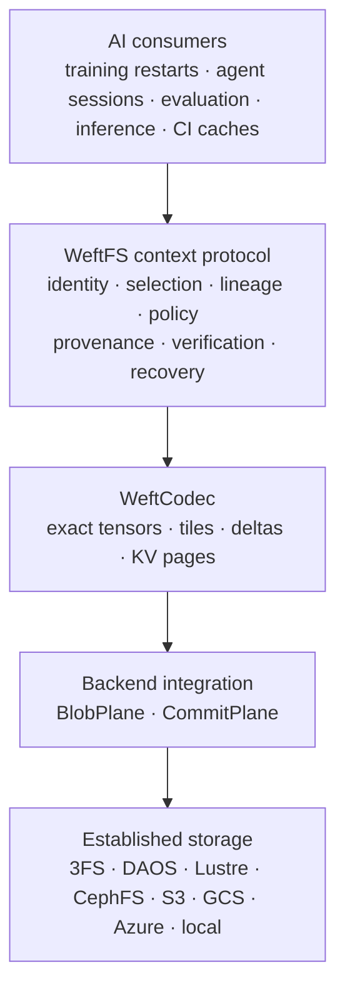

# WeftFS

[](https://github.com/infinityabundance/WeftFS/releases/tag/v1.2.0)

**Context and lossless reconstruction for AI storage infrastructure.**

WeftFS develops a portable context-addressing and reconstruction protocol,
together with WeftCodec, a lossless tensor-aware codec. The architecture is
intended to augment high-performance storage systems used for AI training,
inference, checkpointing and model lifecycle management.

The included Rust and Go filesystems are **reference filesystems** — research
reference implementations that serve as an executable specification of the
protocol. They demonstrate transactional and reconstruction semantics, support
independent conformance testing, and preserve a reproducible record of the
architecture's development. They are not intended to replace or compete with
the data-plane performance of mature distributed filesystems.

The intended deployment architecture combines WeftFS's contextual identity,
reconstruction and provenance machinery with established storage engines such
as DeepSeek 3FS, DAOS, Lustre, BeeGFS, CephFS and JuiceFS, through
backend-specific integration layers that preserve the underlying system's
strengths.

WeftFS is concerned with which data is selected, how it is related,
represented, reconstructed, verified and reused. The underlying storage system
remains responsible for delivering bytes efficiently, consistently and durably
according to its own capabilities.

The research objective is to determine whether this combination can reduce
storage consumption, data movement, repeated computation and recovery cost — or
provide stronger contextual guarantees — without unacceptable overhead on the
underlying storage system. Integration maturity and measured results are
documented separately; compatibility with an interface does not imply that a
native deployment has been benchmarked.

## Architecture at a glance



The protocol and the codec run in the client, in a checkpoint adapter, or in a
backend-specific integration layer. They do **not** own replication, erasure
coding, placement, RDMA, scheduling, caching, or GPU-direct I/O; the storage
system owns those. The `BlobPlane`/`CommitPlane` contract is the complete
interface between WeftFS and a data plane.

Four independent implementations share one normative format. WeftFS separates
the **context plane** (typed relations, Context Roots, causal lineage,
capabilities, and a WeftQL selector grammar compiled to a canonical AST and a
`SelectorId`) from the **storage plane** (an OOM-bounded, transactional,
content-addressed store with snapshots, group commit, GC, crash recovery,
optional blob/commit plane splits, S3/GCS/Azure and 3FS transports, and a
POSIX FUSE frontend). The codec separates *identity* from *representation*: a
tensor's `LogicalTensorRoot` is invariant across raw, zstd, mode-9 float, tiled,
and delta encodings, so the same state can be re-encoded, rebased, or
transcoded without invalidating a single reference. Frozen on-disk and wire
formats are byte-identical across Rust and Go; every claim in this repository
is backed by a court receipt under hard memory, CPU, and pid limits. The Rust
and Go filesystems are reference filesystems implementing this architecture,
not data-plane competitors.

Retention is a binding, not an identity: `spec/WEFT-RETENTION.md` defines a
mutable `weft.retention.v1` record (`volatile` / `session` / `ephemeral` /
`durable`) that references an artifact's existing content root, so changing a
policy never forks dedup or a content root. A class-aware GC planner computes
reachability first and only orders the already-unreachable set by class.

**Writer capability, honestly stated.** The default is **MW1** — many
producers, one committer. **MW2** — independent committers publishing against
one shared authoritative head with typed conflicts, bounded retries, and
linearizable head publication — is implemented and opt-in
(`--writer-mode optimistic`) for the explicit transaction API on `local`/`object`/`3fs`/`s3`
in Rust and on `local`/`object` in Go. FUSE file mutations and generic
checkpoint publication remain MW1. **MW3** — distributed scalable publication
with conflict domains — is not implemented and not claimed. The normative
contract is [`spec/WEFT-MULTIWRITER.md`](spec/WEFT-MULTIWRITER.md); the design,
backend tradeoffs, and every loss are in
[`docs/MULTIWRITER-ARCHITECTURE.md`](docs/MULTIWRITER-ARCHITECTURE.md) and
[`bench/RESULTS-multiwriter.md`](bench/RESULTS-multiwriter.md).

## Integration status

The category names the **strongest executed evidence**, not the design intent.
An interface existing, or an emulator being API-compatible, does not upgrade a
row.

| Integration | Status | Evidence and scope |
|---|---|---|
| Local POSIX backend | *implemented and tested on a real backend* | Default `--backend local`; byte-identical fixtures, crash proxy, and recovery courts. Receipts `backend-20261104T232908Z.json`, `crash-torture-20261104T104233Z.json`. |
| MinIO S3 | *implemented and tested on a real backend* | A real MinIO server (single node, tmpfs data): S3 backend and fenced-writer suites. Receipt `s3-court-20261109T112958Z.json`. |
| Ceph RGW 19.2.0 | *implemented and tested on a real backend* | Independent S3 implementation: backend and fenced-writer suites. Receipt `ceph-rgw-20261109T112958Z.json`. |
| `fake-gcs-server` v1.56.1 | *emulator-tested* | GCS JSON API backend, generation preconditions, fenced writer. Receipt `gcs-court-20261107T034113Z.json`. Not Google Cloud Storage. |
| Azurite 3.35.0 | *emulator-tested* | Azure Blob backend, SharedKey/SAS, fenced writer. Receipt `azure-20261107T034219Z.json`. Not Azure. |
| 3FS | *ABI/conformance-tested only* | USRBIO ABI court over `bench/threefs/hf3fs_shim.c`, loaded with `dlopen`; the shim reports `hf3fs_is_hf3fs = 0`. **Not a deployed cluster.** Receipt `threefs-20261107T020623Z.json`. |
| Buck2 CAS adapter | *prototype* | Store-backed action cache; correctness court 41/41. Not a Buck2 plugin and no REAPI/worker claim. Receipt `buck2-cas-store-correctness-20261109T113544Z.json`. |
| DAOS, Lustre, BeeGFS, CephFS, JuiceFS, IBM Storage Scale, WEKA, VAST, AIStore | *designed but not executed* | No adapter, no court, no deployment. The integration contract is in [`docs/AI-STORAGE-AUGMENTATION.md`](docs/AI-STORAGE-AUGMENTATION.md). |
| Live AWS S3, Google Cloud Storage, Azure Blob | *inaccessible* | No credential or bucket was available; only MinIO, Ceph RGW, `fake-gcs-server`, and Azurite were exercised. |

These categories are deliberately narrow. “Implemented and tested on a real
backend” means a real server process ran in a court, not a live cloud account;
MinIO and Ceph RGW are real S3-compatible servers, but neither is AWS. The
contract, the writer-capability levels (MW0–MW3), and the complete list of
non-claims are in [`docs/AI-STORAGE-AUGMENTATION.md`](docs/AI-STORAGE-AUGMENTATION.md).

## What is measured

| Question | Result from a receipt | Where |
|---|---|---|
| Does reconstruction reduce stored bytes? | Qwen2.5-0.5B base → Instruct family: **1,276,128,956 B** versus **1,535,945,154 B** for independent per-tensor `zstd -19` (**17 % smaller**); **3.07 %** under ZipNN's 1,316,518,229 B; tensor data alone **1,199,958,505 B**. | `planner-float-20261106T035316Z.json`, [`bench/RESULTS-real-model.md`](bench/RESULTS-real-model.md) |
| Does independent tiling make region reads cheap? | Qwen embedding one-row read: **749.26 ms** as one mode-9 frame → **2.12 ms** with tiles (**353×**), at **+0.51 %** physical bytes; a 100-row read falls from **777.08 ms** to **2.30 ms** (**337×**). | `float-tiled-20261107T042955Z.json`, [`bench/RESULTS-mode17.md`](bench/RESULTS-mode17.md) |
| What exactness and recovery evidence exists? | **41/41** verification courts pass at the R4 tree (including the bounded TLA+ model and the two multi-writer courts); **355** conformance vectors; **100,000/100,000** crash iterations with **0** partial states. | `verify-20261109T165707Z.json`, `conformance/manifest.json`, `crash-torture-20261104T104233Z.json` |
| Does multi-writer publication scale? | **No, and it is published as a loss:** 4,000 tx/s at N=1 → 638 tx/s at N=32 (efficiency **0.0050**) on the local backend; a hot name yields exactly one winner and typed conflicts. MinIO N=4: 212.8 tx/s. | `bench-multiwriter-20261109T150423Z.json`, [`bench/RESULTS-multiwriter.md`](bench/RESULTS-multiwriter.md) |

Every number above has a receipt, a `bench/RESULTS-*` analysis, and a list of
what it does not cover. The release-wide summary, including every loss and
every non-claim, is [`docs/RELEASE-v1.2.0.md`](docs/RELEASE-v1.2.0.md). No
single-host measurement is a fleet, cloud, or power-loss claim.

## Repositories

This repository is the program home: it owns the normative specification
(`spec/`) and exports versioned copies to the subprojects.

| Project | Language | Role |
|---|---|---|
| [`WeftCodec`](WeftCodec/) | Rust | Lossless context-conditioned codec, normative format |
| [`WeftCodec-Go`](WeftCodec-Go/) | Go | Independent codec implementation, cross-decode conformance |
| [`WeftFS`](.) | Rust | Reference filesystem: transactional store + Linux FUSE frontend |
| [`WeftFS-Go`](WeftFS-Go/) | Go | Reference filesystem: independent store + Linux FUSE frontend |

## Demonstrated results

The honest headline is a loss, so it goes first.

* **A whole-file `zstd --patch-from -12` still beats the shipped checkpoint
delta on the Pythia fixture.** For pythia-70m step0 → step1 (a 19-byte change
  in 281.7 MB, 76 tensors) the family-lifecycle court measures **42,211 B** of
  per-tensor payload, while one whole-file `zstd --patch-from -12` is
  **30,265 B** — the baseline is **28 % smaller**. The planner now offers an
  in-process `zstd-patch` candidate (mode-4 dictionary frame with a
  base-covering window); a plan-only court measures its payload at **17,923 B**,
  but that total excludes store manifests, commit records, and index segments,
  so it is **not** a like-for-like win over the 30,265 B whole-file baseline.
* **Model family:** Qwen2.5-0.5B base → Instruct stores in **1.276 GB**
  (1.200 GB of tensor data) versus **1.536 GB** for independent per-tensor
  `zstd -19` — **17 % smaller**, and 3.07 % under ZipNN's 1.317 GB.
* **Region reads:** a one-row read of the Qwen embedding takes **749.3 ms** as
  one mode-9 frame but **2.12 ms** as independently decodable tiles — **353×**
  faster, because only the intersecting tiles are decoded; a 100-row read falls
  from **777.1 ms** to **2.30 ms** (**337×**). The cost is **+0.51 % bytes and a
  3.25× write**, which is why the planner only chooses tiles when the access
  pattern pays the write back.

Every number above has a receipt and a list of what it does not cover; see
[`bench/RESULTS-v1.md`](bench/RESULTS-v1.md),
[`bench/RESULTS-real-model.md`](bench/RESULTS-real-model.md),
[`bench/RESULTS-tensor-tiles.md`](bench/RESULTS-tensor-tiles.md), and
[`bench/RESULTS-compression-candidates.md`](bench/RESULTS-compression-candidates.md).
No single-host measurement is a fleet, cloud, or power-loss claim.

## Status

Status is deliberately blunt. Nothing is claimed beyond what has been built and
tested in the Docker court. The phase table records the reference
implementation's development; it is not a product roadmap or a competitor
comparison.

| Phase | Deliverable | Status |
|---|---|---|
| P0 | Repositories, staging workflow, OOM-protected Docker courts, licenses | **Implemented** |
| P1 | Normative specs: model, selectors, codec format, compatibility | **Implemented** (v1 frozen; clarifications recorded in the specs) |
| P2 | Rust WeftCodec v1 (all modes, CLI, tests) | **Implemented** — Rust unit and integration suites pass; 60 codec, 20 WCB, 22 selector, 16 context, 10 causal, 36 adversarial vectors |
| P3 | Golden vectors + independent Go WeftCodec + bidirectional cross-decode | **Implemented** — Go unit/vector suites pass; Rust→Go and Go→Rust decode gates pass for all modes, including byte-identical TENSOR, TOKENS, and QUANTIZED_TENSOR |
| P4 | Rust WeftFS core (transactions, snapshots, graph, recovery) | **Implemented** (store core, no FUSE) — 39 core tests — see [`docs/store-status.md`](docs/store-status.md) |
| P5 | Rust FUSE frontend, POSIX matrix, context views | **Implemented** — 232 Rust FUSE-court tests pass, 0 fail, 2 `#[ignore]`d: ownership needs `CAP_SETUID`; same-inode direct-I/O concurrency hits a reproducible kernel/fuser EIO. Store-level atomicity is tested separately — see [`docs/fuse-status.md`](docs/fuse-status.md) |
| P5a | Commit-time write budgets + branching time travel (Rust + Go) | **Implemented** — admission budgets fail closed with `BudgetExceeded` before publication; usage is a committed-state-derived `quota` record that survives reopen and fails closed on mismatch; `snapshot branch` / `context branch` / union `merge` at parity. Rust `tests/quota.rs` + `tests/branching.rs` (19 tests) and Go `store/quota_test.go` + `store/branch_test.go` (14 tests) pass, including both cross-language directions; bench receipt `bench/receipts/quota-branch-20261105T071244Z.json`, 10,000-version demo receipt `bench/receipts/branching-20261105T071457Z.json` (7/7). See [`spec/WEFT-QUOTA.md`](spec/WEFT-QUOTA.md) and [`bench/RESULTS-quota-branch.md`](bench/RESULTS-quota-branch.md) |
| P6 | Go WeftFS core + FUSE + storage handoff court | **Implemented with documented gaps** — 31 Go tests + 13 GC tests, byte-identical fixture rebuild, bidirectional Rust↔Go handoff and GC. Daemon-side locking, tmpfile, fallocate modes, copy_file_range, and SEEK_DATA/HOLE are implemented; kernel 7.3 rejects COLLAPSE/INSERT before forwarding and physical-space PUNCH_HOLE is not claimed. R20 adds the Rust-equivalent `weft.manifest.v4` overlay writer and compaction, a probed blob/commit plane split, the physical pack plane, and `weft.calibration.v1` loading to Go, with cross-language byte-equality courts. R24 adds Go `calibrate` measurement (a Rust-accepted `weft.calibration.v1` document with the identical id) and FUSE mount coverage for packed, split, and packed-split stores. R25 adds a real **Go S3 backend** — SigV4, `If-None-Match`/`If-Match` planes, the ported fenced writer, all four split layouts — with a MinIO court and 17/17 Rust↔Go checks in both directions. R26 adds **WFX2 selector-index persistence** to Go, byte-compatible with Rust in both directions, cutting the first relation query after a 10k-object reopen from ~16.85 to ~7.75 ms. R26/R27 add a real **Go GCS backend**, the v3 fenced writer, `calibrate --install`, and read-only FUSE mounts over S3 and GCS. Go still has **no Azure backend** and no writable FUSE-over-object run. See [`WeftFS-Go/NOTES.md`](WeftFS-Go/NOTES.md) and [`docs/STATUS.md`](docs/STATUS.md#subphase-r20--go-parity-for-the-r9r12-storage-surfaces-2026-11-06) |
| P7 | Bench courts, receipt bundle, showcase, release | **v1.2.0 released; ongoing** — per-repo GHCR images and crates.io crates, per-repo GitHub releases, verification court, and the codec/store/`fio`/FUSE comparative suites exist. Latest full verification at the release tree: `bench/receipts/verify-20261109T112958Z.json` (**37/37**), including `claims`, `conformance_manifest`, `conformance_coverage`, the five authenticated-capability cross-language courts, `ceph_rgw` against Ceph RGW 19.2.0 running the S3 backend *and* the fenced-writer suite, the MinIO `s3_court`, `threefs` (3FS POSIX byte-identity plus the USRBIO ABI conformance court), `fuzz_diff`, and the Stage S6 courts `checkpoint_family_lifecycle`, `trajectory`, `write_policy`, `recovery_load`, `kv_capability`, `parallel_checkpoint`, and `index_trust`. The first Stage S6 run (`verify-20261108T090639Z.json`, 33/37) is retained because it found four real defects). Losses and gaps are published in [`bench/RESULTS-v1.md`](bench/RESULTS-v1.md), [`bench/RESULTS-comparative-v1.md`](bench/RESULTS-comparative-v1.md), [`bench/RESULTS-fuse-v0.5.md`](bench/RESULTS-fuse-v0.5.md), [`bench/RESULTS-capability-envelope.md`](bench/RESULTS-capability-envelope.md), [`bench/RESULTS-real-model.md`](bench/RESULTS-real-model.md), [`bench/RESULTS-float-tensor-real.md`](bench/RESULTS-float-tensor-real.md), [`bench/RESULTS-checkpoint-topology.md`](bench/RESULTS-checkpoint-topology.md), [`bench/RESULTS-quota-branch.md`](bench/RESULTS-quota-branch.md), [`bench/RESULTS-context-mounts-1000.md`](bench/RESULTS-context-mounts-1000.md), [`bench/RESULTS-merkle-identity.md`](bench/RESULTS-merkle-identity.md), [`bench/RESULTS-tensor-tiles.md`](bench/RESULTS-tensor-tiles.md), [`bench/RESULTS-sparse-delta.md`](bench/RESULTS-sparse-delta.md), and [`docs/PYTORCH-DCP.md`](docs/PYTORCH-DCP.md); no headline performance claim is made. See [`docs/RELEASE-v1.2.0.md`](docs/RELEASE-v1.2.0.md); the previous release note is [`docs/RELEASE-v1.1.0.md`](docs/RELEASE-v1.1.0.md). |
| F2 | Context Roots, capability/budget enforcement, causal identity (Rust + Go) | **Implemented** — 70 Rust tests pass (2 ignored: `CAP_SETUID` ownership and the documented kernel/fuser EIO), Go `store` + `fusefs` pass under `-race`, and Rust↔Go context/causal/capability handoff gates pass. See [`NOTES.md`](NOTES.md) and [`docs/STATUS.md`](docs/STATUS.md). |
| F3 | Context mounts, ambiguity court, time-travel POSIX, replay bundle (A1/A2/A3/A4/D2) | **Implemented** — `mount --context` / `--at` in Rust and Go; default 3-mount demo plus **100 concurrent read-only context mounts** (50 `by:task`, 25 `by:model`, 25 `derived_from` roots; 425 file checks, 100/100 distinct listing digests) and a **1,000 concurrent context-mount court** (500 Rust + 500 Go daemons, 1,000 distinct roots, 4,250 file SHA-256 checks, 1,000 distinct digests, 1,000 cat comparisons, `semantic_match=true`, at explicit `52g / 8 CPUs / 16384 pids` court overrides — at `24g / 8 / 4096` the same court reaches 692 mounted and passes completely at 400, so 1,000 is **not** claimed to fit the default court); ambiguity fails closed and lists every ObjectId; default 100-version plus **10,000-version time travel** (101 snapshots, 10 mounted at once, later live write/rename leaves every snapshot byte-identical); Rust `export-bundle` + independent Go replay. Receipts: `context-mounts-20261103T210625Z.json` (6/6, default), `context-mounts-20261104T125344Z.json` (5/5, 100 mounts, `semantic_match=true`), `context-mounts-20261105T122643Z.json` + `context-mounts-20261105T131116Z.json` (5/5 each, 1,000 mounts, `semantic_match=true`), `context-mounts-20261105T140342Z.json` (INCOMPLETE 692/1000 at the directed limits), `ambiguity-20261103T210633Z.json` (4/4), `time-travel-20261103T210633Z.json` (4/4, default), `time-travel-20261104T125947Z.json` (6/6, 10,000 versions, `semantic_match=true`), `replay-bundle-20261103T210824Z.json` (4/4). Single-host court, synthetic fixtures; not a fleet claim. Time travel is correctness-only: no io_uring/EKBLOOM acceleration is implemented or claimed. |
| F5 | Proof courts: decoder bombs, randomized POSIX torture, crash-consistency torture, receipt bundle (B1–B4) | **Implemented with documented gaps** — 36/36 decoder bombs, 6/6 POSIX runs (13,694 ops), **100,000/100,000 crash iterations at 19.2 it/s** (66,667 old / 33,333 new, 0 partial, 0 failures); one-command bundle verifier. Receipts: `decoder-bombs-20261103T213314Z.json`, `posix-torture-20261103T213317Z.json`, `crash-torture-20261104T104233Z.json`. Crashes are process-fault proxies, not physical power loss; `pjdfstest`/`fsstress` are not available and no substitute run is claimed. |
| F6 | AI codec v1: exact tensor + token modes, cross-language | **Implemented (modes 6–20)** — `TENSOR` (6), `TOKEN_SEQUENCE` (7), `QUANTIZED_TENSOR` (8), `FLOAT_TENSOR` (9, `huffman-canonical-v1`), `TENSOR_SHARDED` (10, `q4_0`/`q8_0`), `WEIGHT_DELTA` (11), `KV_CACHE` (12), `ACTIVATION_STREAM` (13), exact `SEMANTIC_DELTA` (14), `TENSOR_TILED` (15), `SPARSE_DELTA` (16, `zero-run-v1`), `FLOAT_TILED` (17), `FLOAT_TILED_STREAMS` (18), `KV_CACHE_PROV` (19), and **`ENGRAM_SHARD` (20, `weft.ai.engram_shard.v1`)** — region-addressable row groups with per-group roots and an explicit supersession chain — with canonical WCB descriptors, limits, vectors/rejects, CLI, and byte-identical Rust↔Go frames. R7 mode 20 writes only changed groups on update (4/64 groups: 62.7 ms / 16.79 MB vs 499.7 ms / 118.73 MB) but loses whole-table size/decode to one ZSTD frame; see [`bench/RESULTS-engram.md`](bench/RESULTS-engram.md) and `bench/receipts/engram-20261109T232921Z.json`. Remaining brainstormed modes have no wire value. See `spec/WEFT-AI-CODEC.md` and [`docs/RELEASE-v0.5.0.md`](docs/RELEASE-v0.5.0.md). |
| F7 | AI corpus + cost graph (C1/C2) | **Implemented (synthetic)** — 60-file deterministic `bench/corpora/ai-v1` (CC0-1.0, 1.94 MB source / 1.52 MB visible), four strategies with whole-object accounting, cold dependency-DAG latency, and depth. Receipt `ai-corpus-20261104T021627Z.json` (whole-pair-aware planner); results, every loss, and caveats in [`bench/RESULTS-ai-v1.md`](bench/RESULTS-ai-v1.md). No Meta/production data and no superiority claim. |
| F8 | Product/identity hooks: Buck2 CAS, spec-as-code types, agent memory | **Implemented (prototype)** — Buck2 CAS prototype (15/15), generated Rust/Go identity types with a drift court, agent-memory replay demo (7/7), and `QUANTIZED_TENSOR` mode 8 byte-identical Rust↔Go. Not a Buck2 plugin and not REAPI; see [`docs/STATUS.md`](docs/STATUS.md). |
| F9 | Verification: TLA+ model, power-loss/block-layer courts, comparative baselines | **Implemented with documented limits** — TLA+ commit/recovery model with a buggy-model counterexample, QEMU lying-fsync and dm-flakey/blkdebug block-layer courts, whole-disk ZFS/Btrfs plus ext4/XFS `fio` baselines, and SQLite relational/adjacency baselines. Physical media power loss, host page-cache loss, and RAPL energy are **not** claimed. See [`verification/README.md`](verification/README.md). |
| F10 | Real public model checkpoint family: exact ingest, automatic shared/independent representation, storage and restore vs baselines | **Implemented, measured twice** — Qwen2.5-0.5B + Instruct (BF16, 290 tensors, 988 MB each); every restored file matches the Hugging Face LFS SHA-256. F10 (bytes-only planner): ZipNN wins complete storage by 5.27 % (1.317 GB vs 1.390 GB); restore 968.8 ms base / 14,367 ms instruct. **R1 (measured decode table + mode-9 candidate): the storage headline flips — WeftFS is 1,276,128,956 B, 3.07 % under ZipNN and 8.18 % under its own F10 total**; data-only 1.200 GB, indexes 5.92 %. Restore gets slower (13,776 ms base / 26,936 ms instruct; single tensor 111.4 / 221.9 ms). `weft rebase` plans 73 hot instruct deltas to mode 9 without writes. **R2 (decoder throughput, no wire change): storage is byte-identical, and restore is 2.98x faster (base 4,627.5 ms) and 2.37x faster (instruct 11,371.2 ms); mode 9 decode 15,403,165 -> 4,683,726 ns/MiB.** Base read is still 4.8x the zstd-strategy path; parallel reconstruction is not implemented. Receipts `bench/receipts/real-model-20261105T012000Z.json`, `bench/receipts/planner-float-20261106T025351Z.json`, and `bench/receipts/planner-float-20261106T035316Z.json`; every loss in [`bench/RESULTS-real-model.md`](bench/RESULTS-real-model.md). |

Labels used throughout: **implemented** (built and tested), **experimental**
(built, not format-frozen), **conjectured** (design claim without measurement).

## What's new in v1.1.0

Full note with every limit and every loss: [`docs/RELEASE-v1.1.0.md`](docs/RELEASE-v1.1.0.md).
No frozen wire format changed (codec modes 0–17, WFT1, `weft.manifest.v1`–`v4`,
store fixture v1, every conformance vector). The release covers R27 and S1–S5.

- **Fenced publication, one write (R27):** the `LOCK` record is the head
  publication point (`weftfs-{s3,gcs,azure}-lock v3`, carrying
  `pending_generation`/`pending_commit`/`pending_commit_len`); the superblock is
  an attested cache. A writer suspended *after* the fence is refused `Busy`
  after a takeover on MinIO, Ceph RGW 19.2.0, fake-GCS, and Azurite, and on Go
  MinIO. Still one writer; no multi-writer claim.
- **Decode floor (S1):** BF16 whole mode-9 decode 34.7865 -> 18.2186 ms
  (**1.91x**) via vectorised plane join; the AVX2 Huffman kernel is only
  1.07–1.10x in-process and is not selected. Go's word Huffman variant is
  **0.93x** and is not selected. **Mode 17 `FLOAT_TILED`** is additive: on the
  real Qwen embedding it costs **+0.51 %** bytes and 3.25x write time, but a
  100-row read goes 777.1 -> **2.30 ms** (337x) and a 1-row read 749.3 ->
  **2.12 ms** (353x). The planner's access-pattern objective has **no write
  term**; break-even for a 1-row plan is about seven reads.
- **Checkpoint service (S3):** one long-lived `weftfs checkpoint-service`
  process with `SCM_RIGHTS` memfd payloads and a read-only store handle.
  Restore one tensor **2.550 ms** vs 10.386 ms per CLI call (4.07x); restore all
  32 **79.465 ms** vs 96.363 ms; restores grow the store **0 B**. Orbax remains
  **23.85x slower on save and 8.10x on restore**, at +0.44 % bytes.
- **Go GCS and object-mounted FUSE (S4):** Go GCS is a real JSON-API backend
  with `ifGenerationMatch` and the v3 fenced writer; `calibrate --install` now
  matches Rust. Read-only FUSE over S3 and over GCS is evidenced **3/3 files
  byte-identical** each. **No writable FUSE-over-object run exists.** Go still
  has no Azure backend.
- **Lifecycle and governance (S5):** the checkpoint-family court measures
  42,211 B for a consecutive checkpoint versus 144,403,851 B per-tensor
  `zstd -19`, and the zero-trust KV court prices a cached capability check at
  +15 µs fixed (**+83 % at 1 KiB**). The 3FS context plane is a design with a
  shim court, **not a 3FS deployment**; the AI-codec mode index is normative.
  Losses are published: F32 base is 1.20x `zstd -19`, small tensors stay raw
  under region plans, and a 1 MiB tile plan needed a 6 GiB court override.
- **KV prefix cache (T2):** a canonical `weft.kv.prefix.v1` record over mode-12
  pages, exact compatibility (a mismatch fails closed to recompute), parent
  chain page sharing, capability-enforced reads, and logical GC. Court:
  100 prefixes over one system prompt store 103,219,200 B of 286,720,000
  logical B (**dedup 0.64**); authorized get p50 23.4 ms. The reuse-vs-recompute
  decision uses a **declared** prefill model, not an engine measurement; there is
  **no vLLM/SGLang integration and no TTFT claim**. See
  [`docs/KV-PREFIX.md`](docs/KV-PREFIX.md) and
  [`bench/RESULTS-kv-prefix.md`](bench/RESULTS-kv-prefix.md).
- **Verification:** `bench/receipts/verify-20261107T155516Z.json` is **30/30
  courts pass, 0 failed, 0 skipped** at WeftFS `817687d`, WeftCodec
  `99cb87a`, WeftCodec-Go `a0a1ebf`, WeftFS-Go `dc7cfdb`. Conformance:
  Rust/Go 246 pass / 0 fail / 92 skip, Python 229 / 0 / 109, all at manifest
  aggregate `51fa3dd9…` (338 vectors). Two tiled-mode vector directories that
  the reference adapters had silently skipped since mode 15 were wired up in
  `817687d`.
- **Publication:** PyPI remains **unpublished** — no token exists; the exact
  twine failure (`NonInteractive: Credential not found for API token`) and the
  HTTP 404 metadata check are recorded. No live GCS or Azure credential was
  present, so no live cloud run was attempted.
- **Still not claimed:** physical media power loss, host page-cache loss,
  RAPL/joule energy, GPU/TPU execution, live 3FS/Azure/GCS deployments, Go
  Azure, constant-time capability checks, writable FUSE over object stores,
  multi-writer/multi-node/fleet operation, Orbax competitiveness,
  general-purpose-filesystem performance, and PyPI publication.

## What's new in v1.0.0

Full note with every limit and every loss: [`docs/RELEASE-v1.0.0.md`](docs/RELEASE-v1.0.0.md).
No frozen wire format changed (codec modes 0–16, WFT1, `weft.manifest.v1`–`v4`,
store fixture v1, every conformance vector). **v1.0.0 covers codec modes 0–16.**
Mode 17 (`FLOAT_TILED`) is additive and post-v1.0.0; it landed with v1.1.0.
Mode 18 (`FLOAT_TILED_STREAMS`) is additive and post-v1.1.0, so v1.1.0 covers
modes 0–17; it landed in v1.2.0 and is never auto-selected without
`--allow-experimental-modes`. The release is R2–R26; the v0.9.0 notes below cover R2–R13 in
detail.

- **Remote object planes (R10, R14, R21):** probed blob/commit split planes,
  a GCS JSON backend with `ifGenerationMatch`, an Azure Blob backend, and
  GCS service-account RS256 auth (the RFC 7515 A.2 signature vector matches
  exactly). All four local/S3 split layouts reproduce one root and generation.
- **Fenced writers (R17/R18, replaced by R27):** the lease is a fenced record,
  takeover is fence+1, and release is a content-addressed tombstone.
  Adversarial `SIGSTOP` tests pass on MinIO, Ceph RGW 19.2.0, and fake-GCS. R17
  wrote the fence and the head as two conditional writes on two objects; **R27
  makes the head publication one conditional write of the `LOCK` record itself**
  (`weftfs-*-lock v3`, carrying `pending_generation` / `pending_commit` /
  `pending_commit_len`), with the superblock demoted to a validated cache. The
  review's uncovered interleaving (suspended after the fence, takeover without a
  new head) now fails `Busy`. See [`docs/FENCING.md`](docs/FENCING.md).
- **Independent S3 implementation (R16) and Azure SAS (R23):** Ceph RGW 8/8
  compatibility behaviours and 6/6 backend tests; Azurite accepts a real
  service SAS for read-only use (19 backend + 7 fencing tests, 0 failures),
  while a writable SAS open is refused by Azurite’s container check. SAS is
  effectively read-only; account SAS is untested.
- **Go S3 backend (R25):** SigV4 on the standard library, the ported fenced
  writer, `--backend s3`, all four split layouts; MinIO focused **17 pass /
  1 skip**, full `go test -race` 0 failures, cross-language **17/17**.
- **3FS transports (R22):** POSIX is byte-identical to local; the USRBIO ring
  path turns 1,500 requests into 50 submissions. It is **1.127x slower** than
  positional reads in the conformance court, and **no 3FS deployment was run**.
- **Tensor restore pipeline (R19):** ordered producer/consumer with one
  in-order writer; tmpfs restore 4,913.0 -> 2,157.3 ms at 4 threads. No disk
  performance claim: the host bind-mount spread exceeded every mode difference.
- **Orbax adapter (R15):** real JAX/Orbax, 11/11 leaves exact — but **22.2x
  slower save, 126.7x slower full restore, 72.5x slower single leaf, +0.44 %
  bytes**. It is an interoperability result, not a competitiveness claim.
- **Go parity (R20, R24, R26):** v4 overlay writer and compaction (identical
  manifest and head for a fixed clock), pack plane, calibration loading and
  measurement (Rust accepts the Go `weft.calibration.v1` document with the
  identical id), S3, and `WFX2` selector-index persistence (first relation
  query after a 10k reopen 16.85 -> 7.75 ms). At v1.0.0 Go had no GCS/Azure
  backend and no `calibrate --install`; v1.1.0 adds GCS and install (Azure
  remains absent).
- **Verification:** `verify-20261108T031839Z.json` is **30/30 courts pass** at
  WeftFS `bc5c35d`, WeftCodec `6dd7e13`, WeftCodec-Go `70e4701`, WeftFS-Go
  `4b0254f`. The aggregate is unchanged in shape from v0.9.0 (including
  `ceph_rgw`, `s3_court`, `threefs`, and `fuzz_diff`); writer-fence tests run
  inside `s3_court`/`ceph_rgw`. Standalone courts are cited separately:
  Azure/Azurite (`azure-20261107T015947Z.json`), Go S3 (`go-s3-20261107T032512Z.json`),
  3FS `--bench` (`threefs-20261107T020623Z.json`), and the Python court
  (`python-bindings-20261107T015918Z.json`, **349 tests, 0 failures, 9 skipped**).
- **Still not claimed:** physical media power loss, host page-cache loss,
  RAPL/joule energy, GPU/TPU/SIMD decode, any fleet/multi-host/multi-writer
  claim, constant-time RSA, live Azure/GCS/3FS deployments, Go GCS/Azure
  backends, Go FUSE over an S3 store, Go `calibrate --install`, Orbax
  competitiveness, general-purpose filesystem performance, and PyPI publication
  (no token).

## What's new in v0.9.0

This is a historical release note. Several Go gaps named here (v4
writer/compaction, the pack plane, split planes, `calibrate`) were closed in
R20–R27; the current truth is the Status table above and
[`docs/AI-STORAGE-AUGMENTATION.md`](docs/AI-STORAGE-AUGMENTATION.md).

Full note with every limit and every loss: [`docs/RELEASE-v0.9.0.md`](docs/RELEASE-v0.9.0.md).

- **Decoder throughput (R2):** a 12-bit Huffman table decoder (4.7–5.0x Rust,
  4.1–5.3x Go) and a one-pass FLOAT_TENSOR plane join (3.1–5.7x Rust,
  4.8–6.5x Go); Qwen base read **13,775.8 -> 4,627.5 ms (2.98x)** and instruct
  **26,935.7 -> 11,371.2 ms (2.37x)**; the decode table was re-baked. Loss:
  mode 9 is still 6.0x zstd per MiB and materialize is writeback bound.
- **Sparse delta (R3, mode 16):** a 19-word pythia change is **29,887 B
  instead of 7,434,959 B**; dense deltas lose (2.22x, 3.29x, 1.94x) and the
  planner selects per tensor.
- **Seekable tiled decode (R4):** forced-control restore read **3,038.3 -> 1,062.1
  ms at 4 threads**; a 1-row embedding slice reads **730,133 B instead of
  180,625,100 B**; auto-tiling changed zero bytes because mode 9 remained
  smaller.
- **Entropy court (R5):** rANS is 0.5–3.6 % smaller but decodes 2.0x slower;
  Tunstall loses everywhere; **promote nothing**.
- **Python reader (R6):** modes 9–16 with every root check; **326 conformance
  vectors, 218 pass, 0 fail, 108 skip**, and 16,003 randomized frames identical
  to the Rust CLI.
- **Shared mounts (R7):** 100 views in **1 process**, summed RSS **1.96 GB ->
  27.7 MiB**, and 100/100 in a 512 MiB cgroup where per-daemon mounts 51/100.
  Read-only, one backend mutex, one failure domain.
- **Cache and single-flight (R8):** Qwen family **6,645.9 -> 1,140.6 ms
  (5.83x)** at 4 threads, backend reads **3.02 GB -> 107.5 MB**, decodes
  **640 -> 26**; peak RSS rises by about 289 MiB; the thread-local counter fix
  removes the decode-counter flake.
- **Throughput profile and batched publication (R10, 2026-11-10):** an opt-in
  seven-phase profiler (`source_read`, `digest`, `encode`, `blob_publish`,
  `manifest_commit`, `index_segment`, `verify`) shows the 3B planned family
  ingest is **encode-bound** (865.1 s of 920.1 s wall, 89.8 %) while a fast-raw
  8-way checkpoint save is **publication-bound** (771.5 s of 798.3 s, 96.6 %,
  99,103 publications). Packing small blobs through the pack plane with a
  *deferred* catalog (workers publish packs, the single committer publishes the
  catalog) cuts the 3B fast-raw 8-rank save **412.4 -> 145.7 s (2.83x)** and the
  0.5B sequential save **108.9 -> 29.0 s (3.75x)** with identical heads,
  manifests and roots. Losses: zstd-1 and planned split saves get slower
  (0.67x/0.77x/0.85x), the 3B sequential packed store grows 12.3 %, the 8 MiB
  catalog bound leaves 1.54 GB flat, and peak RSS rises 31–43 %. Pipelined
  full-checkpoint restore (bounded tensor workers and tile threads, exact order)
  is byte-identical at 1/2/4/8 workers but only **1.21x** on 3B against a 9.92x
  Amdahl cap, because every blob read serialises on one backend mutex. Full
  verification `bench/receipts/verify-20261110T181259Z.json` (**42/42** courts
  pass); evidence in [`bench/RESULTS-throughput.md`](bench/RESULTS-throughput.md).
- **Training goodput and time-to-safe-resume (R11, 2026-11-10):** a real
  414,432-parameter transformer trains 256 steps with async checkpoints every
  64 in three configurations: **96.22 / 93.75 / 94.17 training steps/s**
  (`torch.save` / local DCP / WeftFS), save pause **0.68 / 0.74 / 3.41 ms**,
  completion **3.9 / 20.1 / 444.1 ms**, and **4,924,427 B per checkpoint** for
  WeftFS (2.00 % under `torch.save`, 6.68 % under DCP). Every one of the 60
  checkpoints restored in a fresh process was bit-exact (**60/60** states,
  **60/60** next-step loss bits, **45/45** post-step states), and SIGKILL
  resume was **1.36-1.39 s** with old-or-new, never partial (**15/15** kill
  runs; 0 partial). Losses: wall **1.20x/1.16x**, the final-checkpoint tail,
  completion **22.1x/115x**, load **10.6x**, and later same-store checkpoints
  about 2x the first. Evidence in
  [`bench/RESULTS-training-goodput.md`](bench/RESULTS-training-goodput.md).
- **Planner v2 and incremental index (R9, 2026-11-10):** the graph objective now
  charges `storage + lambda_write*encode + lambda_retention*bytes +
  lambda_read*reads*restore`, prices each edge with its own measured
  representation row (mode 17/20 and KV/activation are refused
  `UnmeasuredCost`), and accepts an SLA only if `prediction + margin + measured
  uncertainty <= sla`. On the same nine pythia-70m checkpoints **22/22 accepted
  plans held their SLA** (0 missed), and the 850 ms SLA that used to be accepted
  and missed is now refused; every plan class predicts within 15 % (the
  all-independent floor is −14.96 %, page-cache state). Advisory index segments
  became incremental WFX3 deltas: **97,066,019 B -> 3,342,744 B (29.0x)** in the
  1,250-commit court and **104.6 MB -> 6.2 MB** for the trajectory series; peak
  index on the old pinned trajectory is **3.53 GB -> 0.11 GB**. Losses: commit
  p50 **+0.605 ms**, first query after reopen **0.258 -> 1.411 ms** (chain load),
  and a snapshot at every step keeps its chain un-reclaimed. Go writes the same
  bytes and each language loads the other's chain. Full verification
  `bench/receipts/verify-20261110T181259Z.json` (**42/42** courts pass).
- **Overlays (R9):** 500 x 4 KiB writes **917.3 -> 415.5 ms** local and
  **2,308.3 -> 1,702.9 ms** MinIO, with the same content root; compaction
  preserves the root; Go has read-only v4 support.
- **Split planes (R10):** probed blob/commit capabilities (including stale-CAS
  rejection); all four local/S3 layouts reproduce one root and generation.
- **Packs (R11):** 10,000 one-KiB writes **20,003 -> 261** MinIO requests and
  **7,321.5 -> 2,791.7 ms**, at +19.2 % footprint.
- **Calibration and rebase (R12):** host-local `weft.calibration.v1`, Go
  `rebase` parity, and 16 selected hot tensors with instruct restore
  **10,938.8 -> 8,430.9 ms** for **+43,575,360 B**.
- **Distributed court (R13):** **9/9 scenarios, 229 checks, 0 failed** against
  real MinIO, including split planes; it found and fixed a real
  `Corrupt`-versus-`Io` defect.
- **GCS backend (R14, fenced writers in R18):** JSON API with OAuth2 bearer
  tokens and **generation preconditions** (`ifGenerationMatch`), the same
  blob/commit plane contract, and a real `fake-gcs-server` court: same content
  root, generation 21, and commit sequence 1…21 as local, clean `verify --full`,
  and a stale-generation probe that refuses any endpoint accepting a stale
  write. Since R18 the writer lease is fenced on the same protocol as S3:
  takeover, renewal, and release are all generation-conditioned, the fence is
  the last upload before the head CAS, and the shared invariant tests run on
  MinIO, Ceph RGW, and the emulator.
- **3FS transports (R22):** one normative layout behind two transports —
  `--backend 3fs` uses positional I/O through a 3FS mount, and
  `--backend 3fs --threefs-mode usrbio` moves the immutable data plane onto the
  native hf3fs rings (`hf3fs_prep_io`/`submit_ios`/`wait_for_ios`, `dlopen`'d so
  there is no link-time dependency, refused by name when a symbol is missing).
  The POSIX transport is **byte-identical** to the local backend; 1,500 ring
  requests become **50 submissions** with exact bytes; the ring path is
  **1.127× slower** than positional reads in the conformance court, and that
  loss is published. **No 3FS deployment was run**; see
  [`docs/THREEFS.md`](docs/THREEFS.md) and
  [`bench/RESULTS-threefs.md`](bench/RESULTS-threefs.md).
- **Verification:** `verify-20261106T232858Z.json` is **30/30 courts pass** at
  WeftFS `4704ded`, WeftCodec `57288e1`, WeftCodec-Go `86ded1e`, WeftFS-Go
  `3b3695e`; the 28th court is `ceph_rgw` (Ceph RGW 19.2.0, an independent S3
  implementation, running both `s3_backend` and the R17 `s3_fencing` suite),
  the 29th is `s3_court` (MinIO, the same two suites), and the 30th is
  `threefs` (3FS POSIX byte-identity plus the USRBIO ABI conformance court). An
  environment skip at either S3 court is recorded as `skip`, never as a pass.
  The previous 29/29 receipt `verify-20261106T225457Z.json` and the v0.9.0
  release receipt `verify-20261106T141623Z.json` (27/27 at `cef37bc`, before
  `ceph_rgw` joined the aggregate) are retained. The Python
  court reports **331 tests, 0 failures, 9 skipped**
  (`python-bindings-20261106T142616Z.json`).
- **Still not claimed:** physical power loss, host cache loss, RAPL, GPU/SIMD,
  a real 3FS deployment, PyPI publication,
  multi-writer/multi-node/fleet, Go v4 writer/compaction, Go packs, Go
  `--calibration`, Go split parity, Go 3FS transport, and Python
  selectors/context/capabilities/checkpoints/archives.

## What's new in v0.8.0

Full note with every limit and every loss: [`docs/RELEASE-v0.8.0.md`](docs/RELEASE-v0.8.0.md).

- **Mount write path (Q1):** `mount` now defaults to Merkle identity, with opt-in `--write-back` and `--group-commit`. A 4 KiB overwrite p50 falls from 120.0 ms to **7.46 µs** (Rust) and from 422.9 ms to **10.61 µs** (Go); create rises from 162 to **26,548 ops/s** (Rust) and 310 to **6,264** (Go); crash proxy 8/8 old-or-new. Losses: group commit worsens content-write p99 (611–804 ms Rust, 432–478 ms Go), and write-back loses unflushed ranges on a crash by contract.
- **Tiled tensors (Q2):** codec mode 15 `TENSOR_TILED`. A 100-row Qwen slice drops from 130.13 to **12.05 ms** (10.8×) and 7,213,077 to **934,413 B**; a 1-row slice from 129.98 to **3.22 ms** (40.4×) and 281,816 B; the mounted `safetensors` loader reproduces the source SHA-256. Limits: full tiles only, descriptor grows with tile count, no Go mode-15 checkpoint writer.
- **Sparse deltas (R3):** codec mode 16 `SPARSE_DELTA`. A 19-word pythia checkpoint change stores **29,887 B instead of 7,434,959 B** (0.40 % of mode 11, 0.988× a whole-file `zstd --patch-from -3`), 76/76 tensors smaller. Mode 11 remains the right choice for dense deltas: mode 16 is 2.22× larger on step2→step4, 3.29× on step4→step8, and 1.94× larger on the Qwen fine-tune, and `max_sparse_runs` refuses the two densest tensors. Planner, store read path, and vectors in both languages; see [`bench/RESULTS-sparse-delta.md`](bench/RESULTS-sparse-delta.md).
- **Quota in the commit (Q3):** one `set_quota_usage` op replaces a second durable write. Per-commit p50 is **11.344 ms vs 11.278 ms** with no quota (**+0.59%**) and −17.5% against the historical separate-record design; usage is replayed and validated, with a one-time `WFQ1` migration.
- **Real S3 backend (Q4):** SigV4, `If-None-Match`/`If-Match` publication, advisory lease, and a real MinIO court (official binary in a minimal container). **9,442 creates/s local vs 552.6/s S3**; 100 MiB at **520.9 vs 85.6 MiB/s**; byte-identical artifacts. Rust client only at Q4 (Go S3 landed in R25), single-node localhost; not AWS/GCS/3FS/multi-node.
- **PyTorch DCP (Q5):** real torch 2.15.0+cpu `save`/`load`, **9/9 topology-identical restores**, save **1,223.6 ms**, load **152.2 ms**, single-tensor **67.2 ms**, async submit **0.72 ms**, **0.9294×** `torch.save` bytes. Losses: **141× slower save, 30× slower load**; no GPU path, one process.
- **Signed bundles (Q6):** Ed25519 over a canonical manifest, `SIGNATURE OK ed25519:…`, **15/15** acceptance/rejection cases, Go verifier agrees. Signing adds a ~128 KB manifest to a 1,064-file bundle. Non-claims: no CA, transparency log, or rotation; integrity is relative to a key only.
- **Verification:** `verify-20261106T083428Z.json` is **27/27 courts pass** at WeftFS `a4e2c3d` (the R7 shared-mount tree); `verify-20261106T053501Z.json` (27/27 at `36bbbef`, the mode-16 tree), `verify-20261106T052933Z.json` (27/27 at `e4cdc55`), `verify-20261106T044258Z.json` (27/27 at `a8f8a3e`), and the v0.8.0 release receipt `verify-20261106T011444Z.json` (also 27/27) are retained. Retained failures and flakes are listed in the release note.
- **Still not claimed:** physical power loss, host cache loss, RAPL, GPU/SIMD
  paths, a real GCS/Azure/3FS service, PyPI publication, a multi-writer or
  multi-node store, Go parity for checkpoint/training-ready/mode-15 writing, Go
  host calibration, a multi-host rebase policy, and any fleet claim.

### Blob and commit planes (R10, post-0.8.0 work)

`StorageBackend` is now an adapter over two explicit contracts: `BlobPlane`
(immutable chunks, manifests, and indexes) and `CommitPlane` (versioned control
state with compare-and-swap head publication). Capabilities are probed on every
writable open — including a stale compare-and-swap that must be rejected — and
the local, object, and S3 backends implement both planes. An opt-in split puts
blobs and commits on different physical systems (`--blob-backend`,
`--commit-backend`, `--blob-root`); the default is the unchanged single
backend. All four layouts (local/local, s3/s3, s3-blobs/local-commits,
local-blobs/s3-commits) reproduce the same content root, generation, and digest
in the MinIO court; every loss is in
[`bench/RESULTS-planes.md`](bench/RESULTS-planes.md), and the contract,
including what an external metadata engine must implement, is in
[`docs/PLANES.md`](docs/PLANES.md). The writer lease that guards every commit
on a remote commit plane — its record, state machine, covered interleavings,
and explicit non-guarantees — is specified in
[`docs/FENCING.md`](docs/FENCING.md).

### GCS backend (R14, post-0.8.0 work)

A second real object-store backend, `src/gcs.rs`, implements the same
`BlobPlane` and `CommitPlane` over the **GCS JSON API**. GCS's concurrency model
is generation preconditions, not ETags: create-once is
`ifGenerationMatch=0`, compare-and-swap is
`ifGenerationMatch=<observed generation>`, and a failed precondition (`412`) is
the same `Busy` class S3's `412` produces. Authentication is an OAuth2 bearer
token (`--gcs-token`, `WEFT_GCS_ACCESS_TOKEN`, `GOOGLE_OAUTH_ACCESS_TOKEN`), a
**service-account JSON key** (`--gcs-credentials`, `WEFT_GCS_CREDENTIALS`,
`GOOGLE_APPLICATION_CREDENTIALS`) signed with RS256 and exchanged at the key's
`token_uri`, or anonymous for an emulator. The capability probe publishes, attempts a
second create, performs a matching-generation update, and then requires a
**stale** generation update to be rejected; an endpoint that accepts the stale
write is refused `UnsupportedVersion` before any commit. A single `--backend
gcs` store and split layouts (`--blob-backend gcs` or `--commit-backend gcs`)
both work, and the normative object layout is unchanged.

`bash bench/scripts/gcs_court.sh` runs the pinned `fake-gcs-server` `v1.56.1`
binary on loopback inside the rust court: local and GCS produce the same
content root, the same commit sequence, a clean `verify --full`, and a matching
read-only reopen; the crash proxy is old-or-new in all three phases; the
superblock's GCS generation is strictly increasing. Unit tests use an
in-process fake GCS service (no new dependency).

Since **R18** the GCS writer lease is fenced exactly as S3's: `LOCK` is
`weftfs-gcs-lock v2` with the same fields as S3's record, takeover and renewal
are `ifGenerationMatch` uploads, the fence is the last conditional upload
before the head compare-and-swap, release is a conditional tombstone, and a
writer whose own deadline passed refuses before touching the head. The GCS
court now also runs the backend-agnostic invariant suite from
`tests/support/fencing.rs` (7/7), the same bodies MinIO and Ceph RGW run —
receipts `gcs-court-20261106T182003Z.json` and
`bench/receipts/s3-court-20261106T182043Z.json`. Every loss and non-claim — the
emulator is not GCS, no media or cloud claim, single writer only — is in
[`bench/RESULTS-gcs.md`](bench/RESULTS-gcs.md) and
[`bench/RESULTS-fencing.md`](bench/RESULTS-fencing.md).

Since **R21** the service-account path is implemented in
`src/service_account.rs` with no RSA dependency: strict PKCS#8/PKCS#1 DER,
fixed-width Montgomery arithmetic, EMSA-PKCS1-v1_5 SHA-256, load-time proof of
the key, a bounded refresh window, and redacted diagnostics. The cryptographic
core is checked against the published **RFC 7515 Appendix A.2** RS256 vector,
and the court records `no_credentials` rather than claiming a live Google run
(no key exists here). See [`docs/STATUS.md`](docs/STATUS.md).

### Azure Blob backend (R21)

`src/azure.rs` implements the same `BlobPlane`/`CommitPlane` over the Azure Blob
REST API with the existing `ureq` client: `Put Blob` + `If-None-Match: *` /
`If-Match: <ETag>`, ranged `Get Blob`, properties, delete, listing, and
container create. Authentication is SharedKey (HMAC-SHA256 computed here with
`sha2`), a SAS query string, or anonymous. The R17/R18 fenced writer protocol is
ported verbatim, and the endpoint's `If-Match` comparison form is measured at
writable open. `bench/scripts/azure_court.sh` runs pinned Azurite 3.35.0 in the
same hard-limited container: local and Azure produce the same root
`0a8198f5…6c5f`, the same generation sequence, a clean verify, a matching
reopen, and a 3/3 old-or-new crash proxy; the backend suite is 14/14 and the
shared fenced-writer suite 7/7. Azurite is not Azure, and no media, replication,
cloud, or performance claim is made.

### Rebase parity and host calibration (R12, post-0.8.0 work)

`weftfs rebase` now exists in Go with the same selection rule and a
`weft.provenance.v1` receipt, and the planner can use a host-local calibration
file instead of the baked table. `weftfs calibrate` measures this host, writes a
strict `weft.calibration.v1` record, reports its divergence from the baked
table, and can install it under `<store>/calibrations/`; `--calibration FILE`
requires `--planner-cost-model measured` and fails closed on malformed,
incomplete, out-of-range, or non-monotonic rows. The scale court on the cached
Qwen2.5-0.5B family rebased 16 of 32 read tensors with zero prediction
mismatches: selected per-tensor decode **4501.537 ms -> 1900.812 ms**, full
instruct restore **10938.8 -> 8430.9 ms**, representation **+43,575,360 bytes**
for those 16. Every loss, the break-even analysis, and the method are in
[`bench/RESULTS-rebase-scale.md`](bench/RESULTS-rebase-scale.md); receipt
`rebase-scale-20261106T130054Z.json`. The new reopen test also found and fixed a
real consumed-counter persistence bug in both languages.

### Distributed correctness court (R13, post-0.8.0 work)

One court now drives separate writer, reader, and GC processes against a real
MinIO server and checks the distributed contract under failure: a 20-pair
single-writer interlock (`Busy`), old-or-new whole state at every exposed
publication transition (30 crash runs across the single and split layouts, no
mixed generation), idempotent retry after a crash, 8 concurrent readers keeping
the exact pinned bytes across 10 commits, a stale reader that waits for reopen,
fail-closed `Io` with no partial bytes when the server is stopped mid-run and a
clean verify after restart, `gc --apply` racing a snapshot-only reader while a
checkpoint and provenance record are present, and proof that a known `ContentId`
is not authority under an authenticated envelope. The court also found and fixed
a real defect: an unreachable store was reported as `Corrupt`, not `Io`, both at
open and on the read path. Passing receipt:
`distributed-20261106T134839Z.json` (**9/9 scenarios, 229 checks, 0 failed**);
the first failing receipt is retained. Every limit (single node, process faults
rather than media loss, no TCP partition, exclusive writers, Rust client only) is in
[`bench/RESULTS-distributed.md`](bench/RESULTS-distributed.md).

Prior releases: [`docs/RELEASE-v0.9.0.md`](docs/RELEASE-v0.9.0.md) (decoder throughput, sparse and tiled tensors, shared mounts, caches, overlays, split planes, packs, host calibration, distributed court, GCS, Orbax, Ceph RGW, fenced writers, pipelined restore, Go parity, 3FS POSIX/USRBIO, Azure/GCS auth, Azure SAS, Go calibrate/S3/WFX2), [`docs/RELEASE-v0.8.0.md`](docs/RELEASE-v0.8.0.md) (fast mount writes, tiled tensors, commit-time quotas, S3, PyTorch DCP, signed bundles), [`docs/RELEASE-v0.7.0.md`](docs/RELEASE-v0.7.0.md) (real weights, checkpoint topology, quotas, 1,000 mounts, Merkle identity, CAS, conformance) and [`docs/RELEASE-v0.6.0.md`](docs/RELEASE-v0.6.0.md) (authenticated capability envelopes, cross-tenant isolation).

Non-claims: the release note's “Still not claimed” and [`docs/STATUS.md`](docs/STATUS.md).

## Non-negotiable engineering rules

1. **Exactness.** Every decoded byte sequence must match its declared content
   root. Hash mismatch fails closed. No lossy fallbacks.
2. **No invented evidence.** Every performance, reliability, or compatibility
   claim carries a command, environment, fixture, and raw output.
3. **Independent implementations.** Go never calls Rust. The two codecs share a
   format, not code. The two reference filesystems share an on-disk format, not code.
4. **Bounded resources.** Decoders enforce depth, byte, count, and work limits.
   Containers enforce hard memory/swap/pids/CPU limits.
5. **Identity separation.** A selector is a query, not an object. A hash is not
   an authorization token. Ambiguity is returned, never silently resolved.
6. **One writer.** The store is single-writer: enforced by `flock` on a local
   or object namespace, and by a **fenced lease whose conditional write is both
   the fence and head publication** on S3, GCS, and Azure. See
   [`docs/FENCING.md`](docs/FENCING.md). Not a multi-writer protocol.

## Container images

Published on GHCR, anonymously pullable:

```sh
docker pull ghcr.io/infinityabundance/weftcodec:v1.2.0
docker pull ghcr.io/infinityabundance/weftcodec-go:v1.2.0
docker pull ghcr.io/infinityabundance/weftfs:v1.2.0
docker pull ghcr.io/infinityabundance/weftfs-go:v1.2.0
```

`latest` is also published. FUSE mounts require `--device /dev/fuse --cap-add
SYS_ADMIN`; codec and store-only commands do not. See
[`docs/containers.md`](docs/containers.md).

## Rust crates

Published on crates.io:

```toml
[dependencies]
weftcodec = "1.1.0"
weftfs = "1.1.0"
```

```sh
cargo add weftcodec@1.1.0
cargo add weftfs@1.1.0
```

`weftcodec` is the lossless codec/framing library and CLI. `weftfs` is the
transactional store plus FUSE frontend (the `fuse` feature enables mounting).

### Experimental codec representation (opt-in)

The default `raw` policy writes the frozen v1 manifests. The experimental,
`codec-auto` is selected with `--representation codec-auto` in both implementations
and `--codec-min-bytes N` (default 4096); both are global flags and are also
accepted after `mount`, e.g. `weftfs --store DIR mount --mountpoint MNT
--representation codec-auto`. Read-only verbs accept and ignore them, and
`info --json` reports the active policy. `codec-auto` writes `weft.manifest.v2`,
which both the Rust and Go stores now parse, write, verify, and GC. The two
implementations read each other's v2 objects byte-exactly, but their zstd frame
bytes are not claimed identical. Defaults and fixtures are unchanged.

### Mount write path (Q1)

`mount` defaults `--content-identity` to `merkle` for files created through the
mount (every non-mount command keeps `whole-file`, and reads accept both). Two
opt-in flags change the durability window rather than the commit protocol:

* `--write-back` buffers each handle's 4 KiB-range writes and publishes them as
  one commit at `flush`/`fsync`/`release`. `fsync` is durable before it replies;
  a crash loses unflushed ranges.
* `--group-commit` coalesces independent mutations into one durable commit within
  a 10 ms window (max 256 ops). A crash leaves the previous whole generation.

Measured in the FUSE court on 500 × 4 KiB overwrites of a 128 MiB file:
merkle + `--write-back` takes the write p50 from 27.3 ms to 8.8 µs (Rust) and
33.6 ms to 10.7 µs (Go); `--group-commit` takes 200-file create from 162 to
26,548 ops/s (Rust) and 310 to 6,264 (Go). Receipt
`bench/receipts/fuse-writeback-20261105T202300Z.json`, durability table and
losses in [`docs/fuse-status.md`](docs/fuse-status.md) §3. The recommended
AI-artifact mount is `--content-identity merkle --write-back --group-commit`.
Single host, synthetic fixtures, buffered I/O; not a device claim.

## Testing: Docker only

All builds and tests execute inside minimal official images. The host runs
only `git`, `gh`, and Docker. The runner hard-codes OOM protection and refuses
unbounded values:

```sh
scripts/docker-court.sh rust "cargo test --all-targets -- --test-threads=1"
scripts/docker-court.sh go   "cd WeftCodec-Go && go test ./..."
scripts/docker-court.sh fuse "cargo test --features fuse --all-targets -- --test-threads=1"
```

Container defaults: `--memory=3g --memory-swap=3g --pids-limit=1024 --cpus=4`,
`--tmpfs /tmp:size=1m`-bounded (1 GiB), `no-new-privileges`, `cap-drop=ALL`,
and for FUSE only: `/dev/fuse` plus `CAP_SYS_ADMIN`.

### Conformance and third-party decoders

- [`docs/CONFORMANCE.md`](docs/CONFORMANCE.md) — the generated
  `conformance/manifest.json`, the minimal adapter contract,
  `scripts/run-conformance.sh`, reference adapters for Rust, Go, and Python,
  cross-repository identity aggregates, and the coverage gate.
- [`docs/WRITE-YOUR-OWN-DECODER.md`](docs/WRITE-YOUR-OWN-DECODER.md) — a
  step-by-step normative-pointer guide to WFT1, WCB, hashing, modes 0–14, the
  exact check order that determines the error class, and a 50-line decoder
  skeleton.

Fast host-only checks:

```sh
scripts/gen-conformance-manifest.sh --check
scripts/check-conformance-coverage.sh
```

The runner is invoked against an adapter; the shipped adapters wrap the Rust
and Go CLIs (and the independent Python reader). See
[`docs/CONFORMANCE.md`](docs/CONFORMANCE.md) for the exact court commands and
committed pass/fail/skip counts.

## Twelve-step showcase

One command reproduces the mandated end-to-end scenarios (mixed contexts,
context-graph cycle plus acyclic codec DAG, ambiguity, pin stability, Rust FUSE
writes, Rust↔Go handoff, process-fault crash proxies, authorization denials,
and negative compression workloads):

```sh
scripts/docker-court.sh fuse "bash scripts/showcase.sh"
```

The run writes a schema-versioned receipt and its raw console log to:

```
bench/receipts/showcase-<UTC>.json
bench/receipts/showcase-<UTC>.log
```

Every step records its commands, fixture hashes, assertions (checked with
`cmp`, hashes, and JSON field equality), observed outputs, and the court
environment. A determinism re-run compares semantic fields while ignoring
wall-clock fields:

```sh
SHOWCASE_RECEIPT_NAME=showcase-rerun \
SHOWCASE_COMPARE_WITH=/work/bench/receipts/showcase-<UTC>.json \
scripts/docker-court.sh fuse "bash scripts/showcase.sh"
```

A blocked capability is recorded as `"status": "blocked"` with a precise
reason; the script never marks an unobserved step passed.

## F3 demos (context mounts, ambiguity, time travel, replay)

Each demo builds its own deterministic fixture, runs in the FUSE court, and
writes a schema-versioned receipt plus a raw log:

```sh
scripts/docker-court.sh fuse "bash scripts/demo-context-mounts.sh"
scripts/docker-court.sh fuse "WEFT_CONTEXT_MOUNTS=100 bash scripts/demo-context-mounts.sh"
scripts/docker-court.sh fuse "bash scripts/demo-ambiguity.sh"
scripts/docker-court.sh fuse "bash scripts/demo-time-travel.sh"
scripts/docker-court.sh fuse "WEFT_TIME_TRAVEL_VERSIONS=10000 bash scripts/demo-time-travel.sh"
scripts/docker-court.sh fuse "bash scripts/demo-replay-bundle.sh"
```

- **Context mounts** create two byte-identical objects with distinct
  ObjectIds, five typed relations (`task`, `model`, `generated_by`,
  `derived_from`, `prompted_by`), two snapshots at distinct fixed times, and
  mount `by:task=agent-42` (Rust), `by:model=llama-4@ver_19` (Go), and
  `--at 2026-01-01T00:00:00Z` (Go) simultaneously. Every listed file is
  checked against the SHA-256 attribute declared in the store and against the
  BLAKE3 ContentId from `stat`/`context resolve`; a writer commits while the
  three read-only mounts are live.
- **Ambiguity** matches two objects with different ContentIds; the full query
  returns the ordered set, `--require-one` and `context materialize
  --require-one` fail with `Ambiguous` and list both ids, the Context mount
  lists both, and no singular output path is created.
- **Time travel** creates 100 versions of one path, snapshots versions 1, 50,
  and 100, mounts all three at once (Rust + Go), verifies exact bytes, then
  renames and retags the live path and re-reads every mounted snapshot
  unchanged. The scaled mode (`WEFT_TIME_TRAVEL_VERSIONS=10000`) writes 10,000
  versions with a snapshot every 100, mounts ten evenly spaced snapshots
  (`s1`, `s1100` … `s10000`), and repeats the immutability check after a later
  write to the renamed live path.
- **Scaled context mounts** (`WEFT_CONTEXT_MOUNTS=100`) build 200 corpus
  objects, 25 models, 10 grounding docs, 599 typed relations and exactly 100
  distinct Context Roots, spawn all 100 FUSE daemons before awaiting any of
  them, then check every mounted listing digest, every one of 425 mounted
  files against its declared SHA-256, and a representative `weftfs cat` byte
  comparison per mount. The receipt records per-mount latency p50/p95/max,
  wall time to mounted-and-verified, daemon RSS, cgroup peak, and the number
  of surviving daemons after unmount.
- **Replay bundle** writes `bench/bundles/weft-receipt.tar.zst` from Rust and
  verifies it with Go only: extract, `verify --full`, resolve and materialize
  every Context Root, then re-hash every store entry and output file against
  `manifest.json`. The receipt records the bundle SHA-256 and the one-command
  reproduction.

A second run of either scale is compared with the first using
`scripts/showcase/democmp.go` by setting
`WEFT_DEMO_COMPARE_WITH=/work/bench/receipts/<first>.json`; the demo writes
`<second>.determinism.txt` (semantic fields identical, run ids and wall-clock
fields excluded). The scaled receipts also carry a top-level `label` stating
single-host court, synthetic fixtures, local store, and that this is not a
fleet claim.

## F5 proof courts

One command per court; all run only inside `scripts/docker-court.sh` with the
unchanged hard limits.

```sh
# B1: 36 adversarial vectors, both independent CLIs, 10s timeout, class matrix
scripts/docker-court.sh bench "bash bench/scripts/run_decoder_bomb_court.sh"

# B4: fsx-style randomized POSIX ops, 3 seeds, both writer/reader directions
scripts/docker-court.sh fuse "bash bench/scripts/posix_torture.sh"

# B2: process-fault crash proxy through WEFT_CRASH_PHASE (default 1,000)
scripts/docker-court.sh fuse "bash bench/scripts/crash_torture.sh"
# 100,000-iteration run (2026-11-04: 100,000/100,000, 19.2 it/s, 86 min)
scripts/docker-court.sh fuse "WEFT_CRASH_ITERATIONS=100000 bash bench/scripts/crash_torture.sh"

# B3: package and independently verify a receipt bundle
scripts/package-receipts.sh
scripts/verify-receipts.sh bench/bundles/receipts-<stamp>.tar.zst --repo-root .
```

Honest gaps:

- Decoder bombs are a curated 36-vector corpus, not fuzzing or a proof of
  absence. The declared 10 GiB vector is rejected before allocation; no 10 GiB
  payload is produced.
- The POSIX court is a self-written fsx-style harness, not `pjdfstest` or
  `fsstress` (not installed in the court). The verb matrix closes mmap,
  locking (with the documented Rust binding boundary), mknod, fallocate,
  `copy_file_range`, `SEEK_DATA`, and the timestamp surface on Rust; Go covers
  the same verbs in `verbs_test.go`.
- The crash court aborts the process at a publication boundary; it is **not**
  physical power loss and does not drop caches or simulate torn sectors. The
  100,000-iteration run completed in 5,196.2 s (19.2/s) after switching to a
  fresh three-generation store per iteration; the old-or-new/partial checks are
  unchanged. The 10,000-iteration receipt (507.9 s, 19.7/s) is retained.
- The bundle records `dmesg: unavailable (no CAP_SYSLOG)` when the packaging
  user lacks the capability. It is not signed; it is self-verifying against its
  own checksums and, with `--repo-root`, against git revisions.

## Benchmarks

The `bench` court runs the three P7 harnesses under the same hard limits as
the other courts. It is FUSE-capable and includes the external compression
CLIs plus `fio`.

```sh
scripts/docker-court.sh bench "bash bench/scripts/run_codec_ext_bench.sh"
scripts/docker-court.sh bench "bash bench/scripts/run_store_bench.sh"
scripts/docker-court.sh bench "bash bench/scripts/run_fs_bench.sh"
scripts/docker-court.sh bench "bash bench/scripts/run_perf_counters.sh"
scripts/docker-court.sh vm "WEFT_FS_COLD_TARGETS=ext4,xfs,zfs WEFT_FS_COLD_REPS=1 bash bench/scripts/vm_fs_court.sh"
```

Each harness writes a receipt with raw samples and a raw log to
`bench/receipts/`. The current results, every loss, and the remaining gaps are
in [`bench/RESULTS-v1.md`](bench/RESULTS-v1.md); tables can be regenerated with
`bench/scripts/summarize_bench.py` and two receipts compared with
`bench/scripts/compare_bench.py`. The tmpfs filesystem reference is
reference-only and explicitly non-equivalent to WeftFS.

## Repository layout

```
spec/          Normative specifications (single source of truth)
docs/adr/      Architecture decision records
scripts/       Docker court and spec export
docker/        Minimal court images
conformance/   Generated manifest + frozen store/checkpoint/fuzz fixtures
WeftCodec/     Rust codec (canonical vectors under WeftCodec/conformance/v1)
WeftCodec-Go/  Go codec
WeftFS-Go/     Go reference filesystem
src/, crates/  Rust reference filesystem
tests/         POSIX, crash, snapshot, graph, interop courts
security/      Threat model and audit notes
bench/         Contracts, corpora manifests, scripts, receipts
research/      Local-only research notes (gitignored)
```

## Licensing

Code: Apache-2.0. Specification and research prose: CC BY 4.0.
See `LICENSE` and `spec/` headers. Third-party notices are recorded as
dependencies are added.
